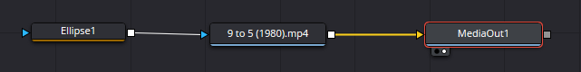
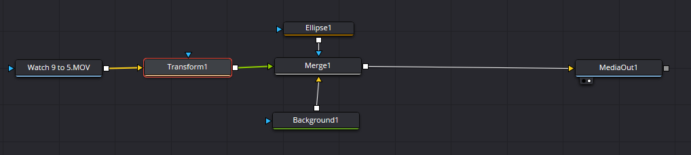

# TDOS pipeline

Builds a DaVinci Resolve timeline from a list of cuts, using a predefined
multicam clip.

Give it a JSON or CSV list of segments and it lays each one down on a new
timeline as an instance of the same multicam clip, trimmed to that segment's
in/out. It drives Resolve Studio directly through its scripting API - there is
no FCPXML or EDL in the middle.

## Setup

```
python src/new_project.py
```

If the movie is an `.mkv`, convert it before anything else:

```
python src/convert_movie.py --project cuts/[movie].media.json
```

This writes `<movie>.mov` beside the original and points the project at it
(the `.mkv` path is kept as `movie_source`). The video is copied untouched
when it's H.264 or HEVC, which takes seconds; anything else is re-encoded to
H.264. The film's main audio track is downmixed to stereo PCM, and both
streams start at exactly 0. Import that `.mov` into Resolve, not the `.mkv`:
the transcript's times are the `.mov`'s. `transcribe.py --project` refuses an
`.mkv` movie for the same reason. A movie that isn't an `.mkv` is left alone.

```
python src/transcribe.py --project cuts/[movie].media.json
```
 

## Desktop app

The long-cut workflow also runs from a window, with no terminal:

```
pip install -r requirements-ui.txt      # once, into .venv
```

Then double-click `TDOS Pipeline.bat` (or `python ui/app.py`).

Pick a project on the left, or make one with **New project**. Each stage has
a button and shows whether it's done: **Convert** (only for an `.mkv` movie,
and Transcribe waits for it), **Transcribe**, **Research**,
**Select cuts**, **Review** and **Build** (dry run, or build in Resolve), plus
one button that runs the three cut stages back to back. The tabs show the cut
list, the `check_cuts.py` findings, the research and review sheets, and the
live log of whatever is running.

Every button runs the same script or skill described below, so the terminal
commands still work and the two can be mixed freely. The three cut stages
run Claude Code headless (`claude -p`), so `claude` must be on PATH and logged
in. What a headless run may do without asking is the `CLAUDE_ALLOWED_TOOLS`
list in `ui/app.py`; a tool call it refuses is listed at the end of the log.

The **Shorts** tab selects, renders, plays and revises shorts (see Shorts
below). `create_timelines.py`, building shorts as Resolve timelines and
editing the cut list are still terminal-only.

## Movie Clip Setups

Hosts with movie



Hosts PIP



## How it works

The multicam clip's **angles are the layouts** (`panel`, `pip_circles`,
`hosts_full`, ...), each one pre-composed in Resolve.

The script does **not** set angles. It sets a **clip colour** per segment
according to the layout the cut list asked for, and you switch the angle by
hand during review. The colour is the suggestion; the angle is your call.

Cut selection itself is a separate, human/LLM step that produces the cut list
this consumes. It runs in three stages, each a Claude Code skill with its
rules in `config/`:

| stage | skill | rules | writes |
| --- | --- | --- | --- |
| 1. Research the film | `/research-film` | [`config/RESEARCH.md`](config/RESEARCH.md) | `cuts/<slug>.research.md` |
| 2. Select the cuts | `/select-cuts` | [`config/SKILL.md`](config/SKILL.md) | `cuts/<slug>.json` |
| 3. Review and fix | `/review-cuts` | [`config/REVIEW.md`](config/REVIEW.md) | `cuts/<slug>.review.md`, revised `cuts/<slug>.json` |

`/make-cuts <title>` runs all three in order. The reviewer keeps the
cutter's original as `cuts/<slug>.draft.json`, so the two can be compared.

Stages 2 and 3 both measure the cut with the same script:

```
python src/check_cuts.py --cuts cuts/<slug>.json
```

It reports runtime and layout mix, `FAIL`s for the hard limits in
`config/SKILL.md` (continuous film audio over 6s, us-only footage over 6s,
more than 4 `panel` segments in a row, overlaps) and `WARN`s for the targets
and judgement calls (layout shares, runs over the 4s default, repeating
patterns, timestamps off a word boundary). It exits 1 on any `FAIL` and never
touches Resolve or the cut list.

## Tightening the hosts-only segments

```
python src/tighten_cuts.py --cuts cuts/<slug>.json --dry-run   # see what it would cut
python src/tighten_cuts.py --cuts cuts/<slug>.json
```

Run after `review-cuts`, before the build (it's the **Tighten** stage in the
desktop app, and the last step of `/make-cuts`). In the layouts where only our
audio is heard (`panel_hosts_only`, `pip_circles_hosts_only`, `hosts_full`)
it reads the reaction waveform and finds the dead air: stretches where nobody
talks or laughs **and** nothing much moves on screen. It then

- trims a silent lead-in or tail, keeping a 0.25s handle before the first
  sound and after the last;
- cuts out a silent pause of 1s or more inside a segment, keeping 0.25s of it
  either side, which splits the segment into two clips (a jump cut).

Motion is measured on what's visible in that layout (the film panel, our
camera, or both), from small sampled frames. Sustained action counts as
something happening, so silence over it is kept as a reaction; a single hard
cut between two still shots doesn't. Our transcribed words always count as
sound. A segment with no sound in it at all is left alone and listed, since
that's a silent reaction the cutter chose on purpose. Film-audio layouts are
never touched.

The silence threshold comes from the recording itself: the room's noise floor
(sampled across the whole recording) plus 18 dB. The cut list is rewritten
in place, and the version before is kept as `cuts/<slug>.pretighten.json`.
Every segment it changed gets `"trimmed_from": [start, end]`, its span before,
so `check_cuts.py` doesn't flag the sound-anchored edges as "not on a word".
It works on a shorts file too, with a much tighter profile (see Shorts), and
splits each segment's `captions` between its pieces. The knobs are the `tighten` block in `config/timeline.json`. It
needs PyAV and numpy (requirements-transcribe.txt), and doesn't use Resolve.

## Setup

Resolve Studio must be **open with your project loaded**, and
Preferences > System > General > "External scripting using" set to **Local**.

No dependencies and no virtualenv - it uses Resolve's own bundled module and
the standard library, and runs on stock system Python 3. The API location is
auto-detected on macOS, Windows and Linux; override `RESOLVE_SCRIPT_API` /
`RESOLVE_SCRIPT_LIB` for a non-default install.

## Run it

Per episode, the only thing you supply is the cut list. Nothing in
`config/timeline.json` is episode-specific, so a new film needs no config edit.

```
# See the plan without touching Resolve - always do this first
python src/build_timeline.py --cuts cuts/<episode>.json --dry-run

# Build it
python src/build_timeline.py --cuts cuts/<episode>.json

# CSV works identically
python src/build_timeline.py --cuts cuts/<episode>.csv
```

**The multicam clip and timeline come from the project template.** Every
episode's project starts from the same Resolve template, which holds a multicam
called `Movie Reaction Multicam` and an empty timeline called `Main Reaction`.
`config/timeline.json` names both, so the long cut is taken from that multicam
and laid into that timeline. For a project that isn't from the template, pass
`--multicam "<name>"` / `--timeline-name "<name>"`; if the multicam name isn't
found, the error lists the candidates.

With `multicam_clip_name` removed from the config, the multicam is found by
scanning the project (it must hold exactly one landscape multicam). With
`timeline_name` removed, the timeline names itself, in precedence order:

```
--timeline-name  >  config timeline_name  >  cut list "title"
                 >  Resolve project name  >  cut list filename
```

The project name sits above the filename because the project is already named
per episode. **You never have to rename the cut list** - keep a fixed
`cuts/current.json` with no `title` and each episode's timeline takes its
project's name. Set `title` only when you want a name that differs from the
project's.

The dry run prints every segment's source in/out, duration, timeline position,
layout and colour, plus total runtime and the layout split by runtime - enough
to check a cut against `config/SKILL.md`'s 35-50 minute and 60-70% targets before
building anything.

The first run fills the template's empty `Main Reaction` timeline. Nothing is
ever overwritten - once that timeline holds a cut, each later run creates a new
one with a numeric suffix ("Main Reaction 2"), so you can iterate on a cut list
and compare versions side by side.

## Shorts

Shorts are the film's most iconic moments with our reactions, one vertical
timeline each. Unlike the long cut, they don't tell the film's story.
Selection rules live in [`config/SHORTS.md`](config/SHORTS.md). The
`select-shorts` skill mines `cuts/<slug>.research.md` (the beat sheet the
`research-film` skill writes), ranks candidates by how iconic the moment
is and how big our reaction was, and writes `cuts/<slug>.shorts.json`.

Shorts keep the long cut's film-exposure limit: no more than 6 seconds of
continuous film audio (4 by default), and no short over 35 seconds.
`python src/check_cuts.py --cuts cuts/<episode>.shorts.json` reports each
short's `FAIL`s and `WARN`s.

### Rendering shorts without Resolve

```
pip install -r requirements-shorts.txt                                   # once
python src/render_shorts.py --cuts cuts/<episode>.shorts.json --preview  # a still per short
python src/render_shorts.py --cuts cuts/<episode>.shorts.json            # all shorts
python src/render_shorts.py --cuts cuts/<episode>.shorts.json --short 2  # just one
```

Writes a finished 1080×1920 MP4 per short, straight from the two media files:
a black title band on top ("First Time Watching" over "The Thing (1982)"),
the film under it full width (a wider film cropped at the sides), the two of
us in a full-width frame under that, black below, and word-by-word captions
on the seam, film lines in one colour and ours in another. The title lines are
templates in `config/shorts.json` (`{title}`, `{year}`, `{hook}`). The year
comes from the media config's `year` or the `(1982)` in the movie's file name.

Before rendering, tighten the shorts (the **Tighten** button in the Shorts
tab; `select-shorts` runs it itself):

```
python src/tighten_cuts.py --cuts cuts/<episode>.shorts.json
```

On a shorts file it cuts much harder than on the long cut, and it covers
`panel` too, where the film's dialogue and loud sound count as sound but quiet
score under a still shot doesn't.

All text stays inside the **social safe zone**, the part of the frame that
YouTube Shorts, TikTok and Reels don't cover with their own UI. The default is
the strictest of the three, so one render is safe on all of them: clear of the
top 270px, the bottom 670px, the left 120px and the right 200px (the
like/comment/share column). The title sits in the part of the band below the
top margin. Text is centred on the frame, and moves left only when it would
reach into the button column. `--preview --safe-zone` shades what's outside it red on the stills. The
captions are the `captions` phrases `select-shorts` writes per segment, timed
from the transcripts. A short with a `FAIL` is not rendered.

Videos go to a `Shorts` folder beside the reaction recording, each with a
`.txt` holding its YouTube title and description. Fonts, colours, sizes,
audio levels and the `safe_zone` margins are in
[`config/shorts.json`](config/shorts.json). The renderer refuses a config
whose hook band or caption seam would land outside the safe zone. Two things are
per project, in `cuts/<slug>.media.json`:

| key | meaning |
| --- | --- |
| `shorts_hosts_crop_x` | which part of the camera frame the bottom shows: `0` left edge, `0.5` centre, `1` right edge |
| `shorts_sync_nudge_seconds` | plays the film later (+) or earlier (-) against our reactions |

Nothing syncs the film to the recording here except `movie_offset_seconds`
(our mics don't hear the film), so if a short's film runs early or late
against our reactions, that nudge is the fix.

### Editing shorts in the app

Each short card has an **Edit** button that opens a timeline editor over that
short, so you can change it yourself instead of sending feedback to Claude.

It plays small proxy copies of the two recordings, because the originals (a 4K
`.mov` past 10GB, PCM audio) are too heavy for the window's player. Make them
once per project with **Make proxies** in the Shorts toolbar, or:

```
python src/make_proxies.py --project cuts/<slug>.media.json
```

That writes `<media>.proxy.mp4` (640 px wide, AAC, a keyframe every half
second) and `<media>.peaks.json` (the waveform) beside each original. A 4K
feature-length recording takes about 20-25 minutes; the film takes a few. The
render still reads the originals.

In the editor:

- **Monitor:** the short as it will look - title band, film, us, the caption
  on the seam - playing the proxies. Film audio is heard only on film + us
  clips.
- **Timeline:** clips in play order with their waveforms (ours yellow, the
  film's blue) and transcript words as ticks; captions on the track below.
  - Drag the ruler to scrub.
  - Drag a clip's edge to trim or extend it into the recording (later clips
    move up or down to follow).
  - Drag a clip to reorder it; click it to select it.
  - Edges snap to word edges, the playhead and the frame grid; hold Alt to
    drag freely.
  - Drag captions to move or resize them, and double-click one to edit its
    text.
- **Inspector:** exact in/out with frame nudges, film + us / us only, caption
  text and speaker, and the short's name, YouTube title, hook text and
  description.
- **Checks:** the same FAILs and WARNs as `check_cuts.py`, live, and the
  runtime against 15-30s.

| key | does |
| --- | --- |
| Space | play / pause |
| Left / Right | a frame back / on (Shift: a second) |
| S | split the clip at the playhead |
| Delete | delete the selected clip or caption |
| L | toggle film audio for the clip |
| Ctrl+Z / Ctrl+Shift+Z | undo / redo |
| Ctrl+S | save |

**Save** writes just that short into `cuts/<slug>.shorts.json` (the file as it
was is kept as `cuts/<slug>.shorts.prev.json`); **Save & render** then renders
it. Save refuses if something else rewrote the file while the editor was open
(a Claude revision, Tighten), and is disabled while one of those runs. Clips
whose times you change lose their `trimmed_from` mark.

In the desktop app this is the **Shorts** tab: select the shorts, watch each
rendered one in the window, and send feedback on a short to have Claude revise
just that one (the version before is kept as `cuts/<slug>.shorts.prev.json`).

### Building shorts as Resolve timelines

```
python src/build_timeline.py --cuts cuts/<episode>.shorts.json --dry-run
python src/build_timeline.py --cuts cuts/<episode>.shorts.json            # all shorts
python src/build_timeline.py --cuts cuts/<episode>.shorts.json --short 2  # just one
```

The builder spots a shorts file by its `"shorts"` array. For each short it
creates a 1080×1920 timeline named `<Title> Short <n> - <name>` and lays the
segments down **in the order listed**. Shorts aren't chronological: a hook
can flash forward, and segments may repeat source time.

It cuts from the project's **portrait** multicam: a vertical multicam with
the same angles in the same order as the 16:9 one, recomposed for 9:16
(Stack / Movie focus / Hosts stack; see SHORTS.md's LAYOUTS). With both
multicams in one project, the long cut picks the landscape one and shorts the
portrait one, so neither needs `--multicam`. If there's no portrait multicam,
shorts fall back to the only multicam and say so, and you reframe by hand.

## Cut list format

JSON array, or CSV with the same column names. `start`, `end` and `layout` are
required; `film_beat`, `iconic` and `reason` are carried for your reference and
don't affect the build.

```json
{ "start": 842.10, "end": 848.60, "layout": "panel",
  "film_beat": "...", "iconic": true, "reason": "..." }
```

An optional `fix` note flags a segment for rework by hand. A flagged segment gets
the `fix_color` clip colour instead of its layout colour, and a red timeline
marker spanning it, with the note in the marker. Resolve has no red clip colour,
so the marker is the red. The dry run lists the flagged segments.

Times are seconds from the start of the recording, per `config/SKILL.md`
(Resolve exports SRT with a 01:00:00:00 start, so subtract 3600).

A JSON object wrapping the array under `segments`, `cuts` or `edit` is also
accepted, so an LLM's output doesn't need reshaping by hand. **Per-episode
facts belong in that wrapper**, which is what keeps the config generic:

```json
{ "title": "Repo Man",
  "movie_offset_seconds": 458,
  "segments": [ ... ] }
```

`title` overrides the timeline name (optional - the project name covers it).
`movie_offset_seconds` is the offset that converts
film-subtitle times to recording time - `config/SKILL.md` needs it as `[OFFSET]` when
selecting cuts; the builder just carries it. See `cuts/repo-man.json`.
`select-cuts` also writes `hook` and `near_misses` there for the review stage;
the builder ignores them.

## Config

[`config/timeline.json`](config/timeline.json):

Everything here is a standing preference, set once and left alone:

| key | meaning |
| --- | --- |
| `fps` | must match the multicam clip; a mismatch warns loudly |
| `sync_offset_seconds` | added to every timestamp. `0` while multicam frame 0 == recording time 0 |
| `timeline_start_timecode` | `01:00:00:00` |
| `layout_colors` | layout -> one of Resolve's 16 clip colours |
| `shorts_resolution` | `[width, height]` of each shorts timeline. Default `[1080, 1920]` |
| `fix_color` | clip colour for segments flagged with `fix`. Default `Orange` |

| `multicam_clip_name` | the template's multicam for the long cut: `Movie Reaction Multicam` |
| `timeline_name` | the template's empty timeline the long cut fills: `Main Reaction` |

Both names apply to the long cut only. Shorts still find the portrait multicam
themselves and are named after the episode. Pass `--multicam` /
`--timeline-name` for a one-off.

## Frame accuracy

Both endpoints are converted from absolute seconds with `Fraction`, so 29.97
and 23.976 stay exact and **error never accumulates** over a 40-minute
timeline. Every cut lands within half a frame of its true time, which is the
property that matters: `config/SKILL.md` requires each timestamp to be an SRT cue
boundary, and cuts that drift land mid-word. A segment's duration is a derived
consequence and may differ from nominal by at most one frame.

Unsupported frame rates fail loudly rather than rounding to a neighbour - a
genuine flat 30 is never treated as 29.97, and vice versa.

## Validation

The cut list is fully validated before Resolve is touched. The build refuses to
run on: `end` <= `start`, negative starts, segments shorter than one frame,
unknown layout names, overlapping or out-of-order segments (the edit is
chronological), colours outside Resolve's 16, or an fps with no exact rate. All
problems are reported at once, not one per run.

## Two Resolve API traps, both verified the hard way

Both were caught only by reading the built timeline back out of Resolve. Both
produced a build that **reported success** and looked right at a glance.
Verify by read-back, not by return value.

**`endFrame` is exclusive.** Much of the community documentation says it is
inclusive. On Resolve Studio 20 it is not: `GetDuration()` comes back as
`endFrame - startFrame`. Passing `round(end*fps) - 1` "for inclusivity"
shortened all 95 segments by exactly one frame - a 95-frame total error that no
spot check would surface. A segment covering `[start, end)` passes
`endFrame = round(end*fps)` unmodified.

**`mediaType` is not a video+audio flag.** `1` means video *only*, `2` means
audio *only*. Passing `1` built a completely silent 38-minute timeline - 95
video clips, 0 audio clips. Omit the key entirely to get both.

See `plan_segments()` and `build_timeline()` in `src/build_timeline.py`.

## Verifying a build

1. Clip count on V1 matches the dry run's segment count.
2. The audio track has the same clip count as V1 - see the `mediaType` trap.
3. Spot-check a cut: park on a clip boundary and compare its source timecode
   against the dry-run table's "source in" column.
4. Clip colours match the "layout" column - scan for them at a glance.
5. Total runtime matches the dry run.
6. Open the multicam in the viewer, confirm angle switching works, then set
   angles per the colour coding.

A read-back check asserting all of this against the cut list is worth running
after any change to the build path.

## Why not FCPXML or EDL

An earlier version of this repo generated FCPXML/EDL via OpenTimelineIO and
imported it. That approach is gone: **neither format can express a Resolve
multicam clip**, so it could not do this job at all.

Driving Resolve directly also retired three problems that route had to work
around - `file://` percent-encoding for paths with spaces and parens,
`<library><event>` wrapping to satisfy Resolve's FCPXML importer, and clip
markers that Resolve's FCPXML importer silently drops. Media relinking stops
mattering too, since the multicam clip is already in the project.
